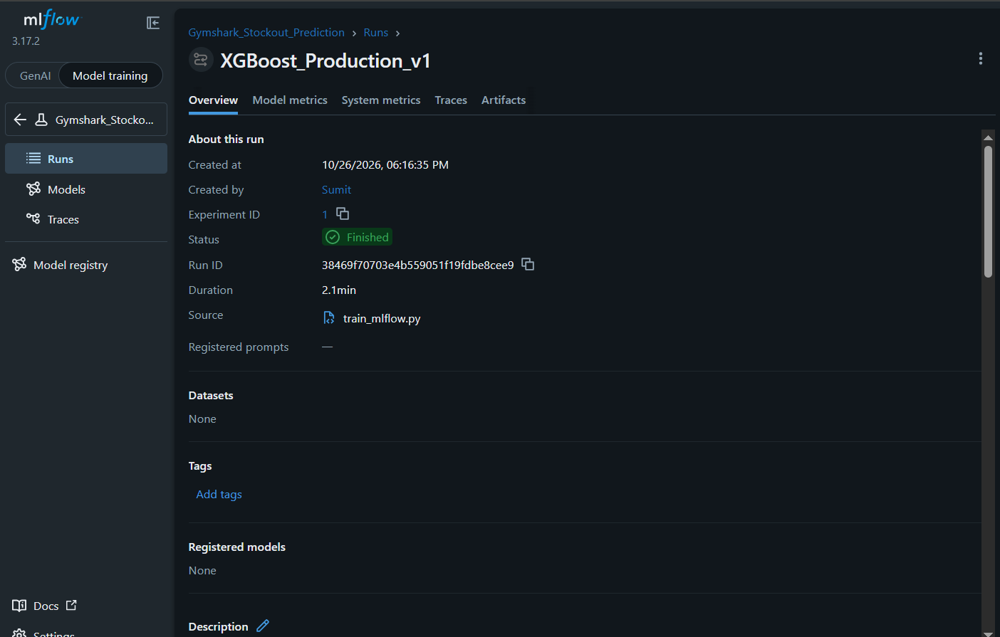

# Competitor Catalog Intelligence: Gymshark End-to-End Data Project

**Data engineering + analytics + machine learning + MLOps, built on a live public product catalog.**

> **The problem it solves:** Online brands and sellers need to know what competitors are discounting and which products are likely to run out of stock. This project collects a competitor's public catalog, stores it in a warehouse, shows pricing and stock insights in Power BI, scores stock-out risk with an ML model, and serves that score through an API.

**Dashboard screenshots:** below | **Author:** [Sumit Gavali](https://github.com/SumitGavali)

---

## What you get

| Layer | What it does | Key files |
|---|---|---|
| Ingestion | Pulls ~9,900 products from the public Shopify `/products.json` endpoint into AWS S3, partitioned by date (`raw/shopify/dt=YYYY-MM-DD/`) so daily runs build history without overwriting | `ingest.py` |
| Warehouse | DuckDB reads the raw JSON from S3, flattens the nested `variants` array with SQL `UNNEST`, and writes Parquet "gold" tables | `transform.py`, `gold_data/` |
| Analytics | A 4-page Power BI dashboard on catalog mix, pricing, discounts, and stock-out predictions | `powerbi/` |
| ML | XGBoost classifier for stock-out risk | `Training.ipynb`, `train_mlflow.py` |
| MLOps | MLflow experiment tracking, champion/challenger promotion, FastAPI serving, batch scoring | `train_mlflow.py`, `ab_test.py`, `app.py`, `generate_pred.py` |

## Architecture

```
Shopify /products.json  ->  S3 (raw, date-partitioned)  ->  DuckDB + SQL  ->  Parquet (gold)
                                                                               |-> Power BI (4 pages)
                                                                               |-> XGBoost + MLflow -> champion/challenger -> FastAPI + batch scores
```

**Tech stack:** Python, Requests, AWS S3, DuckDB, SQL, Parquet, Power BI (DAX), scikit-learn, XGBoost, Pandas, MLflow, FastAPI, Joblib

## Dashboard

**Page 1: Executive summary** (KPI cards, gender split, top product types)


**Pages 2 and 3: Pricing and discounts** (which categories are discounted most, for example Dresses at up to 70%)


**Page 4: Stock-out risk predictions** (output of the model)


## Key insights

1. **Unisex dominance:** 78% of the catalog is classified as "Unisex," heavily skewed towards T-shirts and shorts.
2. **Discount strategy:** Discounts reach 70% on low-ticket items such as dresses and accessories, likely to clear old inventory.
3. **Stock-out risk:** The model flagged 2,782 SKUs (24% of live inventory) as high risk of selling out. T-shirts and leggings are the highest-risk categories.


| Metric | Value |
|---|---|
| Accuracy | 92.17% |
| Recall (out-of-stock class) | 96% |

Recall was prioritised because missing a real stock-out costs more than a false alarm, which just means holding some extra safety stock.

### Limitations (read this before trusting the numbers)

- **The current model classifies stock status from a single catalog snapshot.** It is a risk score, not a true forecast of what will sell out next week. A real forecast needs several daily snapshots to learn how stock changes over time.
- Features such as discount and product age may partly reflect stock status itself. A time-based validation is on the roadmap to check for leakage.
- Data comes from one brand's public catalog. Results do not transfer to other brands without retraining.

## MLOps

1. **Experiment tracking (`train_mlflow.py`):** logs hyperparameters (`n_estimators`, `max_depth`) and metrics for every run, so any model can be traced and compared.
2. **Champion/challenger (`ab_test.py`):** a newly trained challenger replaces the production champion only if it beats the champion's ROC-AUC by at least 2%.
3. **Serving (`app.py`):** a FastAPI endpoint returns a stock-out risk probability for a POST request with product details.
4. **Batch scoring (`generate_pred.py`):** scores all live inventory (excluding items already out of stock) and exports a CSV that feeds the Power BI predictions page.



## Quick start

```bash
git clone https://github.com/SumitGavali/END-TO-END-DATASCIENCE.git
cd END-TO-END-DATASCIENCE
pip install -r requirements.txt        # [ADD requirements.txt if missing]

python ingest.py                       # needs AWS credentials set as environment variables
python transform.py                    # builds Parquet gold layer in gold_data/
python train_mlflow.py                 # trains and logs to MLflow
python ab_test.py                      # champion/challenger check
uvicorn app:app --reload               # serve the model at http://127.0.0.1:8000/docs
python generate_pred.py                # batch-score live inventory
```

## Roadmap

- [ ] Run `ingest.py` daily for 30+ days to build a snapshot history
- [ ] Train a true time-to-stock-out model on the history, with time-based validation
- [ ] Add price-change and discount alerts (WhatsApp or email)
- [ ] Support multiple competitor stores in one dashboard
- [ ] Dockerise the pipeline and API
- [ ] Add unit tests and a GitHub Actions workflow

## Data and ethics

The project reads only publicly available product data from a public endpoint. Check a site's terms of service and `robots.txt` before collecting data from it. For client work, use the client's own data or their competitors' public pages, and keep client data private.

## Work with me

I build competitor price/stock tracking and sales dashboards for Indian D2C brands and marketplace sellers.
Contact: `sumitrg0007@gmail.com` | LinkedIn: `https://www.linkedin.com/in/sumit-gavali-99bbb7337/` | GitHub: [@SumitGavali](https://github.com/SumitGavali)

---

**Also by me:** [`kaggle-prep`](https://pypi.org/project/kaggle-prep), a data-profiling CLI on PyPI.
